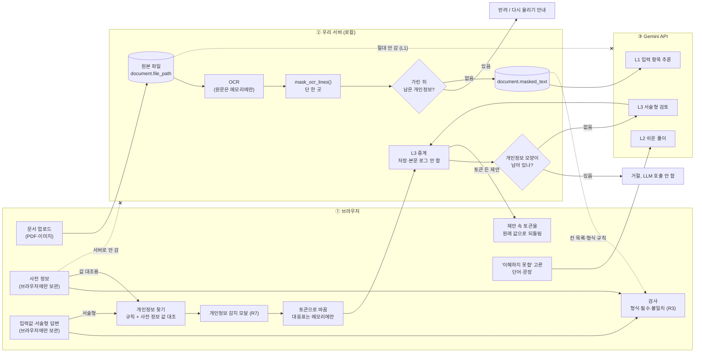

# 개인정보 데이터 흐름도

- 작성: 석준영 (sjy0128) · 2026-11-17 (2026-11-16 데일리 로그의 '개인정보 설계' 작업)
- 상태: **초안 (Claude 작성, 팀 확인 전)**
- 전제 (팀 결정): **사전 정보와 입력값(서술형 답변 포함)은 서버에 저장하지 않는다.** 결정 기록: [`docs/decisions/no-server-storage-user-input.md`](../decisions/no-server-storage-user-input.md) (2026-11-17 회의 합의)
- 근거: `03-rules-states-llm.md` R1·R3·R4·R7·R8·R9·R10·R11·R12, T3·T4, 3-4 L1~L3 / `backlog.md` US-01~US-05·US-07 / `STACK.md` A안
- 같이 보는 문서: 항목별 보관·전송·삭제는 [`pii-items.md`](pii-items.md), 서술형 마스킹 설계는 [`l3-masking.md`](l3-masking.md), OCR 마스킹 코드는 [`prototypes/masking/`](../../prototypes/masking/)

> 규칙 내용은 옮겨 적지 않고 번호(R·T·L·US)로만 가리킨다.
> 필드 이름은 팀 확정 전인 `DATA-MODEL.md` 초안 기준이다. 위 전제와 다른 부분은 `pii-items.md` 4절에 모았다.

## 1. 경계

| 구역 | 무엇이 있나 | 개인정보 원문 |
| --- | --- | --- |
| ① 사용자 브라우저 | React 화면, 원본 문서 미리보기, **사전 정보, 입력값, 서술형 답변** | 있음 (본인 기기) |
| ② 우리 서버 (각자 Mac, 로컬) | FastAPI, OCR, OCR 마스킹 함수, SQLite, 업로드 파일 | 업로드 원본 파일만 저장. 서술형은 **가린 글이 지나가기만 함** |
| ③ 외부: Gemini API | L1·L2·L3 호출 | **없어야 함** (가린 글만) |
| ④ 외부: Google 로그인 | 로그인 | 로그인에 필요한 것만 (`DATA-MODEL.md` `user`) |
| ⑤ 실제 기관 | 공식 신청 사이트 | 서비스는 **아무것도 보내지 않는다** (R4·R10) |

## 2. 흐름도

- 실선: 실제로 데이터가 지나가는 길. 점선 ✕: 지나가면 안 되는 길
- 사전 정보·입력값은 서버로 가지 않는다. 서술형 답변만 **가린 글**이 서버를 지나 Gemini로 간다 (LLM은 서버에서만 부른다, `CLAUDE.md`)
- ⑤ 실제 기관으로 가는 화살표는 **없다** (R4·R10)

## 3. 경로별 설명

| # | 경로 | 서버가 받는 것 | Gemini로 나가는 것 | 막는 곳 | 근거 |
| --- | --- | --- | --- | --- | --- |
| P1 | 업로드 → OCR → 마스킹 → L1 | 원본 파일 | 가린 OCR 텍스트, 칸 위치, 라벨, 사용 언어 | `mask_ocr_lines()` 한 곳 + 다시 검사 | R1, US-01, US-02, L1 |
| P2 | 재분석 → L1 | '원본과 다름' 표시(사유 글 없음) | P1 값 + 표시한 항목 | 사용자 글을 받지 않는다 | US-03 |
| P3 | 사전 정보·입력값 → 검사 | **없음** | **없음** | 브라우저 안에서 비교한다. 서버는 칸 목록과 형식 규칙(허용 목록)만 내려 준다 | R3, R8, R11, US-04 |
| P4 | 서술형 답변 → 감지 → 모달 → 가림 → L3 → 되돌림 | **가린 답변**과 질문(칸 안내 문구) | 가린 답변, 질문, 사용 언어 | 브라우저에서 가림 + 서버에서 다시 검사. 자세한 것은 [`l3-masking.md`](l3-masking.md) | R6, R7, US-05, L3 |
| P5 | 고른 단어·문장 → L2 | 고른 글자 | 고른 글자, 용어 사전 설명, 사용 언어 | **아직 없음 → 5절 #1** | R5, L2 |
| P6 | 로그인 | `google_sub`·`email` (Google에서) | 없음 | 토큰·비밀번호를 저장하지 않는다 | R8 |
| P7 | 취소 | - | - | 서버: 문서·입력 항목 삭제. 브라우저: 그 작성 건의 입력값 삭제 | R12, T3, US-07 |

## 4. 마스킹을 하는 곳 두 군데

| | OCR 문서 (P1) | 서술형 답변 (P4) |
| --- | --- | --- |
| 어디서 | 서버, OCR 직후 `mask_ocr_lines()` 한 번 | 브라우저에서 가리고, 서버가 보내기 전에 다시 검사 |
| 왜 거기서 | 원본 파일이 서버에만 있다 | 답변 원문을 서버로 보내지 않기로 했다 (전제) |
| 찾는 방법 | 값 모양(정규식) + 라벨 뒤 값 | 값 모양(정규식) + **사전 정보 값과 같은 글자** |
| 바꾸는 모양 | `[전화번호]` (종류만) | `[전화번호1]` (번호를 붙여 되돌릴 수 있게) |
| 남으면 | `residual=True` → LLM 안 부름 | 서버가 거절 → LLM 안 부름 |
| 원래 값으로 되돌리나 | 안 함 | 함 (브라우저에서, 사용자에게 보여 줄 때만) |

OCR 마스킹의 알려진 한계: 라벨 없이 문장 속에 있는 이름은 규칙으로 찾지 못한다 → 5절 #3. 서술형은 사전 정보 값과 대조하므로 **본인 이름은** 찾을 수 있다 (`l3-masking.md` 2절).

## 5. 확인 필요·미정 (팀 결정 필요)

| # | 문제 | 왜 문제인가 | 후보 (결정은 팀) |
| --- | --- | --- | --- |
| 1 | P5(L2)에 막는 곳이 없다 | 화면이 원본 파일을 보여 주므로 사용자가 문서 속 자기 이름·번호를 골라 '이해하지 못함'을 누르면 원문이 Gemini로 나간다. 풀이는 사용자 사이에도 같이 쓴다 (`DATA-MODEL.md` `easy_explanation`) | ㉠ 브라우저에서 P4와 같은 검사를 하고, 걸리면 보내지 않음 ㉡ 고를 수 있는 글자를 `masked_text` 안으로 한정 |
| 2 | **성공 판정(R9)을 서버가 확인할 수 없다** | `CLAUDE.md`는 "상태 변경은 서버 규칙 검증과 사용자 확인 뒤에만"이라고 하는데, 서버에 입력값이 없다 | ㉠ 브라우저가 검사 결과 요약(남은 필수 칸 수, 확인 안 한 불일치 수, 미결정 제안 수, 미결정 개인정보 수)만 보내고 서버는 그 숫자로 판정 ㉡ 판정할 때만 값을 보내고 저장하지 않음 ㉢ 성공 판정도 브라우저에서 |
| 3 | 브라우저 어디에 보관하나 | 메모리면 새로고침하면 사라지고, `localStorage`·IndexedDB면 개인정보가 기기에 평문으로 남는다. 다른 기기에서는 다시 입력해야 한다 (R11 "다시 묻지 않는다"가 같은 브라우저 안에서만 지켜짐) | 보관 위치와 지우는 때 (미정) |
| 4 | OCR 문서 속 문장의 이름 | 규칙으로 못 찾음 (`test_known_limit_name_in_sentence`) | ㉠ 업로드 직전 브라우저가 사전 정보 이름을 서버에 보내 대조 — **전제와 충돌** ㉡ 한계로 두고 시연 문서에서 확인 |
| 5 | 가린 뒤 개인정보가 남았을 때의 상태 | `03` 3-2는 `반려`(R1), `backlog.md` US-01은 '업로드됨에 머문다' | `PRD.md` 8절 상태 이름 문제와 같이 정함 |
| 6 | Gemini 무료 티어의 입력 데이터 처리 | 무료 티어에서 보낸 내용이 서비스 개선에 쓰일 수 있다고 알고 있음 **[추정]** | Gemini API 약관·개인정보 처리 안내를 직접 열어 확인 (확인 필요) |
| 7 | 서버 로그 | L3 중계 요청 본문을 로그에 찍으면 가린 답변이라도 서버에 남는다 | 로그에는 작성 건 id·상태·사유 코드만 남기는 규칙을 코드 스타일에 넣을지 |
| 8 | 원본 파일 보관 기간 | 지금은 `취소` 때만 지움. `성공` 뒤에도 남는다 | T3을 넓힐지 (기간 값 미정) |
| 9 | OCR 출력 형식 | OCR 엔진 미정. 프로토타입은 '줄 텍스트 + bbox'로 받는다 | 엔진이 정해지면 확인 (확인 필요) |
| 10 | 주민등록번호·외국인등록번호 구분 | 뒷자리 첫 숫자(1~4·9·0 / 5~8)로 나눴다 **[추정]** | 출처 확인 필요. 틀려도 둘 다 가려지므로 영향은 토큰 이름뿐 |
