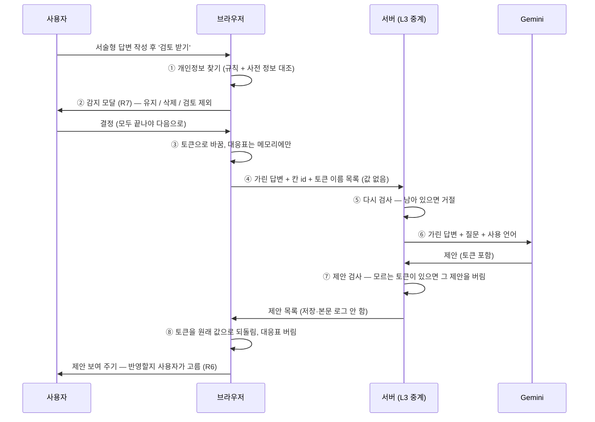

# 서술형 답변 마스킹 설계 (L3)

- 작성: 석준영 (sjy0128) · 2026-11-17
- 상태: **초안 (Claude 작성, 팀 확인 전)**. `[제안]`은 팀이 정할 값이다
- 전제 (팀 결정): 사전 정보와 입력값(서술형 답변 포함)은 서버에 저장하지 않는다
- 근거: `03-rules-states-llm.md` R6·R7·R8, 3-4 L3 / `backlog.md` US-05 / `CLAUDE.md` "LLM은 FastAPI 서버에서만 호출"
- 흐름 위치: [`data-flow.md`](data-flow.md) P4

## 1. 목표

서술형 답변을 L3로 검토받되, **답변 속 개인정보 원문이 서버와 Gemini 어디에도 가지 않게** 한다.
LLM은 서버에서만 부르므로 답변은 서버를 지나야 한다. 그래서 **브라우저에서 가린 뒤 보내고, 돌아온 제안은 브라우저에서 되돌린다.**

## 2. ① 개인정보 찾기 (브라우저)

| 방법 | 찾는 것 | 비고 |
| --- | --- | --- |
| 규칙(정규식) | `pii-items.md` 2절의 종류: 주민·외국인등록번호, 전화번호, 이메일, 주소, 긴 숫자 | OCR 마스킹과 **같은 규칙 목록**을 쓴다 (아래 '규칙 한 벌') |
| 사전 정보 값 대조 | 사전 정보 4개(이름·생년월일·연락처·주소)와 같은 글자 | 사전 정보가 브라우저에 있어서 가능하다. OCR 마스킹이 못 찾는 **문장 속 본인 이름**을 여기서 찾는다 |
| 사용자가 직접 고름 `[제안]` | 규칙이 못 찾는 것 (자녀 이름, 병명, 학교 이름 등 R7 예외) | 답변에서 글자를 골라 '가리기'를 누르면 같은 방식으로 토큰이 된다 |

사전 정보 값 대조 방법 `[제안]`

| 사전 정보 | 같다고 보는 경우 |
| --- | --- |
| 이름 | 전체 이름, 그리고 공백으로 나눈 각 부분 중 2글자 이상 (예: `NGUYEN VAN A` → `NGUYEN VAN A`, `NGUYEN`, `VAN`) |
| 생년월일 | `1990.01.01`, `1990-01-01`, `19900101`, `900101`, `1990년 1월 1일` |
| 연락처 | 하이픈·공백을 빼고 숫자가 같으면 |
| 주소 | 전체 주소, 그리고 도로명+번호 부분 (예: `다라로 12`) |

- 비교는 공백·하이픈을 무시하고 하되, 찾은 위치는 **원래 글자 위치**로 돌려준다
- 규칙과 대조가 같은 곳을 찾으면 한 번만 가린다

**규칙 한 벌** `[제안]`: 정규식 목록을 서버가 JSON 하나로 내려 주고, 브라우저 감지(①)와 서버 재검사(⑤)가 같은 목록을 쓴다. 두 곳의 규칙이 어긋나지 않게 하기 위해서다. 지금 규칙은 `prototypes/masking/masking.py`의 `_PATTERNS`에 있다. Python 정규식이 JavaScript에서도 똑같이 동작하는지는 **확인 필요**.

## 3. ② 감지 모달과 결정 (R7)

R7대로 결정 전에는 보내지 않는다. 결정마다 L3로 가는 모양은 이렇게 제안한다.

| 사용자 결정 | 답변 (브라우저) | L3로 가는 것 |
| --- | --- | --- |
| 유지 | 그대로 둔다 | 그 자리를 **토큰**으로 바꿔 보낸다 |
| 삭제 | 그 부분을 지운다 | 지운 답변 |
| 검토 제외 | 그대로 둔다 | 그 부분이 든 **문장을 통째로 빼고** 보낸다 (주변 내용도 보내고 싶지 않을 때) |

> **팀 결정 필요:** R7은 '유지'면 그대로 보낸다고 읽힌다. 이 설계는 '유지'여도 원문은 보내지 않고 토큰만 보낸다. R7보다 엄격한 쪽이다. 받아들이면 `03` R7 문구와 `backlog.md` US-05 인수 조건을 팀이 고친다.

## 4. ③ 토큰 규칙

| 규칙 | 내용 |
| --- | --- |
| 모양 | `[종류N]` — 예: `[이름1]`, `[전화번호1]`, `[전화번호2]`. 종류 이름은 `pii-items.md` 2절 토큰과 같다. 사용자가 직접 고른 것은 `[가림N]` |
| 번호 | 종류마다 1부터. **같은 값은 같은 토큰**을 쓴다 (LLM이 같은 사람·번호인 줄 알게) |
| 대응표 | `{ "[이름1]": "홍길동", … }`. 브라우저 **메모리에만** 두고 ⑧이 끝나면 버린다. 서버로 보내지 않는다 |
| 서버로 보내는 것 | 가린 답변 + 토큰 **이름** 목록 (`["[이름1]", "[전화번호1]"]`). 값은 없다 |
| 답변에 원래 `[ ]` 모양 글자가 있으면 | 토큰과 헷갈리지 않게 보내기 전에 `［ ］`(전각 괄호)로 바꾸고 되돌릴 때 원래대로 `[제안]` |

## 5. ④~⑦ 서버 중계

서버는 저장소가 아니라 **통로**다. 받은 답변과 제안을 DB에 넣지 않고, 요청·응답 본문을 로그에 찍지 않는다.

| 단계 | 서버가 하는 일 | 실패하면 |
| --- | --- | --- |
| ④ 받기 | `draft_id`, `form_field_id`, 가린 답변, 토큰 이름 목록. 질문(칸 안내 문구)은 서버에 있는 `form_field.guide_text`(이미 가린 값)를 쓴다 | - |
| ⑤ 다시 검사 | 토큰을 지운 답변에 규칙 한 벌을 다시 돌린다. 걸리면 LLM을 부르지 않는다 (브라우저가 가리기를 빠뜨렸거나 우회한 경우) | `422`, 사유 코드 `PII_REMAINING` `[제안]` |
| ⑥ Gemini 호출 | 프롬프트에 "`[…]` 토큰은 글자를 바꾸지 말고 그대로 둘 것, 토큰 안의 값을 짐작하지 말 것"을 넣는다 | 호출 실패는 기존 L3 오류 처리 |
| ⑦ 제안 검사 | 각 제안의 고친 문장에 든 토큰이 보낸 목록 안에 있는지 본다. **없는 토큰이 생겼거나 토큰 글자가 바뀐 제안은 버린다.** 토큰이 빠진 제안은 둔다 (개인정보를 빼자는 제안일 수 있음) | 버린 개수만 로그에 남김 |

## 6. ⑧ 되돌리기 (브라우저)

- 제안의 고친 문장에서 토큰을 대응표 값으로 바꿔 사용자에게 보여 준다
- 사용자가 '반영'을 고르면 되돌린 문장이 답변이 된다 (R6)
- 대응표는 되돌린 뒤 버린다. 답변을 다시 고치면 ①부터 새로 한다 (`DATA-MODEL.md` "서술형 값이 바뀌면 다시 검토")
- 검토 제안은 서버에 저장하지 않으므로 브라우저가 들고 있는다. 보관 위치는 `data-flow.md` 5절 #3과 같이 정한다

## 7. 예시 (가짜 값)

| 단계 | 내용 |
| --- | --- |
| 사전 정보 | 이름 `홍길동`, 연락처 `010-0000-1234`, 주소 `서울특별시 가나구 다라로 12` |
| 원래 답변 | `저는 홍길동입니다. 01000001234로 연락 주세요. 다라로 12 근처에 삽니다.` |
| ① 찾기 | `홍길동` (사전 정보 대조), `01000001234` (규칙 + 대조), `다라로 12` (규칙 + 대조) |
| ② 결정 | 셋 다 '유지' |
| ③ 서버로 | `저는 [이름1]입니다. [전화번호1]로 연락 주세요. [주소1] 근처에 삽니다.` + `["[이름1]", "[전화번호1]", "[주소1]"]` |
| ⑥ L3 제안 | `저는 [이름1]입니다. 연락은 [전화번호1]로 부탁드립니다. [주소1] 근처에 살고 있습니다.` |
| ⑧ 화면 | `저는 홍길동입니다. 연락은 01000001234로 부탁드립니다. 다라로 12 근처에 살고 있습니다.` |

## 8. 테스트 시나리오 (테스트 담당 참고)

| # | 경우 | 기대 |
| --- | --- | --- |
| 1 | 사전 정보 이름이 문장 속에 있음 | `[이름1]`로 가려 보낸다 |
| 2 | 같은 전화번호가 두 번 나옴 | 둘 다 `[전화번호1]` |
| 3 | 감지가 있는데 결정 전 | 서버 요청을 보내지 않는다 (R7) |
| 4 | 가리지 않은 전화번호를 서버로 직접 보냄 | `422 PII_REMAINING`, Gemini 호출 0번 |
| 5 | LLM이 `[이름2]`(보내지 않은 토큰)를 만들어 냄 | 그 제안은 버려진다 |
| 6 | LLM이 토큰을 뺀 제안 | 제안이 그대로 보인다 |
| 7 | 되돌린 뒤 | 대응표가 남아 있지 않다 |
| 8 | 요청 처리 후 서버 DB·로그 | 답변 글이 없다 |

## 9. 정해야 할 것

| # | 내용 | 담당 후보 |
| --- | --- | --- |
| 1 | '유지'도 토큰으로 보낼지 (3절) — R7·US-05 문구 변경 | 팀 투표 |
| 2 | '사용자가 직접 가리기' 기능을 MVP에 넣을지 | 팀 (`mvp-scope.md`) |
| 3 | 규칙 한 벌을 서버가 내려 주는 API를 둘지 | 서버·화면 담당 |
| 4 | Python 규칙이 JavaScript에서 같게 동작하는지 | 확인 필요 |
| 5 | Gemini가 토큰을 지키는 비율 | 저장한 응답이 아니라 **실제 호출**로 확인해야 한다 (`CLAUDE.md` "L1~L3 동작을 확인할 때만") — 미확인 |
